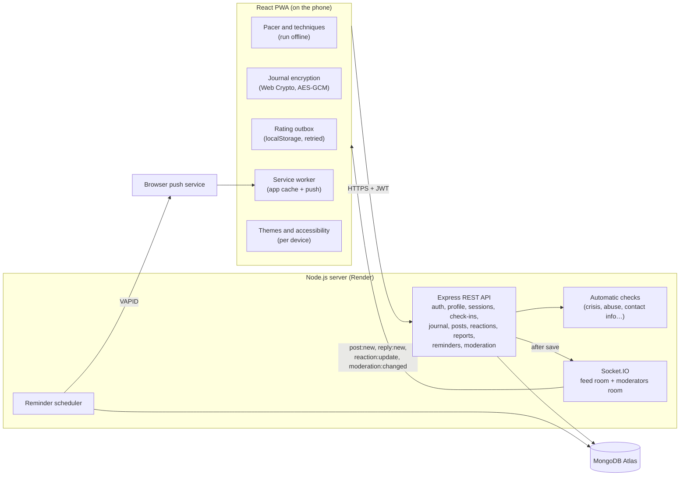

# Luma

A self-support tool for panic and anxiety. Luma opens straight into help (no signup, no login, no menus), learns which calming technique works for each person and at what time of day, keeps a private end-to-end encrypted daily journal, checks in gently, and has an anonymous, moderated live community for peer support.

> Luma is self-support and peer support. It does not diagnose, treat or replace professional care. In India, call Tele-MANAS on 14416, or 112 in an emergency.

**Live app:** https://luma-jkr8.onrender.com · **Demo video:** _add link here_

## Problem Statement

- **Barriers in a crisis.** Most wellness apps put account creation, onboarding or subscription prompts in front of help. Someone in the middle of a panic episode cannot get through that.
- **One size fits all.** Apps offer a fixed set of exercises, but techniques work differently for different people, and even for the same person at different times of day. For some, focusing on the breath makes an episode worse.
- **Wanting connection without exposure.** People who struggle often want to reach others going through the same thing, without their identity attached, and in a space that is kept safe.

## Target Users

- People in the middle of a panic or anxiety episode, who need something calming within seconds, usually on a phone and often on a weak connection.
- People with recurring anxiety who want to learn what works for them, track it over time, and keep a private journal.
- People who want support from others going through the same thing, without revealing who they are.

Luma is built for India first (its helplines are Indian) and designed for smartphones.

## Solution

1. **Instant help.** The first screen is a tap-along breathing pacer. The person taps each time they breathe in; Luma measures their own rhythm, starts the guide at that pace, and slows it about 5% per breath toward six breaths a minute.
2. **A personal go-to that knows the time of day.** Onboarding answers and a practice round give each technique a starting score. Every rated session updates it, overall and for mornings, afternoons, evenings and nights. Luma opens the best technique for *right now* and says why ("Picked for nights: it lowered your distress by 2.5 points on average"). **"This isn't helping"** moves to the next best in one tap.
3. **Gentle daily care.** A one-tap mood check-in, a daily journal page with a rotating prompt, and optional reminders, with nudges that never guilt ("Good to see you. There is nothing to catch up on.").
4. **Progress that means something.** Streaks, distress before and after over time, a mood line, a 12-week activity map, and which technique helps at which time of day.
5. **A safe anonymous community.** Threaded replies, supportive reactions, automatic checks that hold risky posts and surface people who may be in crisis, and a moderator dashboard.
6. **Comfort and access.** Four colour themes in light and dark, a low-stimulation mode, high contrast, text size, reduced motion and breath haptics.

## Key Features

The core workflows, all working end to end:

| Workflow | What the user does | What happens behind it |
| --- | --- | --- |
| **Guest help** | Opens Luma, taps along with the pacer | Rhythm measured on the device (median tap gap, double taps ignored), guide slows each breath. Works offline after first load. |
| **Onboarding** | Answers 4 questions, tries techniques and rates them | Answers and practice ratings become a prior score per technique; finishing sets the go-to |
| **Returning user** | Opens Luma; the right technique for this time of day starts; rates it afterwards | Rating is queued on the device, synced idempotently, and the overall and time-of-day rankings are recomputed |
| **Daily check-in and journal** | Taps a mood and what's affecting it; writes today's page | One check-in and one encrypted page per day (editable that day); calendar of past pages; feeds streaks and charts |
| **Progress** | Opens the progress tab | Server builds a day-by-day series, streaks and per-time-of-day results from the person's local dates |
| **Reminders** | Chooses check-in, journal or practice reminders and days; turns on notifications | Scheduler sends a Web Push once per day in the person's timezone; missed ones wait quietly on the home screen |
| **Community** | Posts, replies to replies, reacts | Live over Socket.IO under per-thread anonymous handles; automatic checks run on every message |
| **Moderation** | A moderator reviews the queue and approves or removes, optionally pausing the writer | Crisis items first, then held and hidden items; decisions are logged; the feed updates live |

**The four techniques:** tap-along breathing pacer, 5-4-3-2-1 grounding, progressive muscle relaxation, and mental grounding prompts. Each is a full-screen flow with two large buttons: **I feel calmer** and **This isn't helping**.

### How the go-to is chosen

Each technique gets a score per user:

```
score = (priorScore × k + sum of improvements) / (k + numberOfSessions)          k = 3
```

- `improvement` = distress at the start − distress at the end (1–5 scale).
- `priorScore` starts at 1 and is adjusted by onboarding answers (for example, "focusing on my breathing makes it worse" lowers the pacer by 0.8) and by practice ratings (0.4 per point away from 3).

Then, for each time of day, the overall score becomes the prior:

```
timeScore = (score × k_t + sum of improvements at that time) / (k_t + sessions at that time)    k_t = 2
```

With no evening data, the evening ranking equals the overall one; a few evening sessions are enough to shift it. When the best technique for a time of day has at least two sessions there, Luma shows the reason. The logic lives in [`server/src/lib/techniques.js`](server/src/lib/techniques.js) and [`server/src/lib/ranking.js`](server/src/lib/ranking.js), with tests.

### How moderation works

Every post and reply goes through [`server/src/lib/moderation.js`](server/src/lib/moderation.js) before it is saved:

| Check finds | What happens |
| --- | --- |
| **Crisis language** ("I want to die", "can't go on"…) | Post stays **visible** (being heard matters). The writer immediately sees helplines. The post goes to the **top** of the moderators' queue. |
| Abuse aimed at others, contact details (phone, email, @handle), links, descriptions of self-harm methods, shouting or repeated characters | Post is **held**: only the writer sees it, labelled "waiting for review", until a moderator approves it |
| The same text posted twice within 30 minutes | Rejected with a clear message |

Community reports add to this: content is hidden after reports from **3 different people**, after **2** if the checks had already flagged it, and immediately if a moderator reports it. Moderators see the text, the reasons, the flags and the writer's history (earlier removals, whether paused), **never their identity**. They can approve, remove, or remove and pause posting for 1, 3 or 7 days. Every decision is recorded in a log with an optional note. The queue updates live.

## Tech Stack

| Layer | Choice | Why |
| --- | --- | --- |
| Frontend | React 19 + Vite, React Router | Fast single-page app; calm screens load first, other pages load on demand |
| Installable app | PWA (manifest + Workbox service worker via `vite-plugin-pwa`) | Installs to the home screen, works offline, receives push notifications |
| Backend | Node.js + Express 5 | REST API, validation (Zod), rate limiting, helmet |
| Real-time | Socket.IO | Live posts, replies, reactions and the moderator queue |
| Notifications | Web Push (`web-push`, VAPID) + an in-process scheduler | Reminders arrive when the app is closed |
| Database | MongoDB (Mongoose); MongoDB Atlas in production | Users, profiles, sessions, check-ins, ciphertext journal, posts, reactions, reports, reminders, moderation log |
| Auth | JWT + bcrypt, member and moderator roles | Accounts are optional; protected routes check ownership and role |
| Encryption | Web Crypto API (PBKDF2-SHA256, 310k iterations → AES-GCM 256) | Journal readable only on the person's device |
| Charts | Recharts | Trend lines; colours checked for colour-blind separation |
| Design | "Moonlit": Cormorant (headings), Jost (body), a breathing moon on a starry sky; Dawn light mode, low-stimulation and high-contrast modes | Calm, readable, distinctive |
| Tests | Vitest, Supertest, socket.io-client; Playwright walkthroughs | 59 API tests, 11 client tests |

## Architecture



- **Writes always go through REST.** Posting is validated, checked, rate-limited and tied to an account there; Socket.IO is broadcast-only. Moderators join a separate room after their token is verified on connect.
- **Local time, not server time.** The app sends the local date and hour with sessions, check-ins and journal pages, so "today", streaks and time-of-day rankings match what the person lived, in any timezone.
- **Anonymity.** Author ids are stored (for rate limits, one-report-per-person, deleting your own, pauses) but never sent to clients or moderators. Handles are an HMAC of user id and thread id: stable inside a thread, different in every thread.
- **Threads.** Replies keep a parent link and a depth (indentation stops at 3). A deleted reply that has answers becomes a placeholder, so the conversation still reads.
- **Offline ratings.** A rating is saved on the device first with a random `clientId`; a unique index on `(user, clientId)` makes retries harmless.
- **Journal.** Only ciphertext and IVs are stored. Daily pages are one per local date (unique partial index) and store which built-in prompt was shown. The key exists only in memory while unlocked.
- **Reminders.** Each pass claims a reminder for the day with a conditional update before sending, so it is never sent twice, even with two servers. Revoked browser subscriptions are removed automatically.

### Data model

| Collection | Holds |
| --- | --- |
| `users` | Email, bcrypt hash, role, journal salt and verifier, guidelines accepted, warnings, posting pause, push subscriptions |
| `techniqueprofiles` | Onboarding answers, practice ratings, onboarding complete |
| `sessions` | Technique, before and after, `clientId`, local date, local hour, time of day |
| `checkins` | Local date (unique per user), mood 1–5, tags |
| `journalentries` | Kind (daily or note), local date, prompt id, ciphertext and IV only |
| `posts` | Handle, text, status (visible, held, removed), hidden, flags, crisis, review state, reaction counts, embedded replies (same fields + parent, depth) |
| `reactions` | One per person per item per type |
| `reports` | Reporter, item, reason, open or resolved |
| `moderationactions` | Moderator, item, decision, pause, note, excerpt |
| `reminders` | Kind, time, days, timezone, enabled, last sent date |

### API

| Method and path | Auth | Purpose |
| --- | --- | --- |
| `POST /api/auth/signup`, `/login` | none | Create account, log in (rate-limited) |
| `GET /api/auth/me`, `POST /api/auth/guidelines` | user | Current user, accept community guidelines |
| `GET /api/profile`, `PUT /onboarding`, `PUT /practice`, `POST /complete` | user | Rankings (overall and by time of day) and onboarding |
| `POST /api/sessions`, `GET /api/sessions`, `GET /stats`, `GET /trends` | user | Save a rating (idempotent), history, per-technique stats, progress series and streaks |
| `PUT /api/checkins`, `GET /api/checkins` | user | Today's check-in, recent check-ins |
| `GET /api/today` | user | Today's check-in, nudge, due reminders |
| `GET /api/journal/meta`, `POST /setup` | user | Journal salt and verifier |
| `GET/PUT/DELETE /api/journal/daily/:date`, `GET /daily` | user | Daily pages (ciphertext) and calendar |
| `GET/POST /api/journal/entries`, `DELETE /entries/:id` | user | Free notes (ciphertext, own only) |
| `GET /api/posts` | optional | Feed with threads and reactions; your held posts included for you |
| `POST /api/posts`, `POST /api/posts/:id/replies` | user + guidelines, not paused | Post and reply (checked, rate-limited) |
| `POST /api/posts/:id/reactions` | user | Toggle a reaction |
| `DELETE /api/posts/:id`, `/replies/:replyId` | author | Delete your own |
| `POST /api/reports` | user | Report a post or reply |
| `GET/PUT/DELETE /api/reminders/:kind`, `POST /push/subscribe`, `/push/unsubscribe`, `/push/test` | user | Reminders and notification devices |
| `GET /api/moderation/queue`, `POST /decision`, `GET /log`, `GET /stats` | moderator | Review queue, decisions, audit log |

Every error has the same shape: `{ "error": "message to show", "code": "MACHINE_CODE", "fields": { ... } }`.

### Error handling

Luma is used during distress, so a failure never blocks help or shows a raw error, and the pacer stays reachable whatever else fails.

| What can go wrong | What Luma does |
| --- | --- |
| No internet | Techniques keep working offline; a banner says so; ratings queue on the device and sync on reconnect |
| Rating fails to save | Stays in the outbox and is retried; the server ignores duplicates |
| Wrong journal passphrase | AES-GCM verification fails and Luma says the passphrase didn't unlock the journal |
| Journal save fails | The text stays in the box with the reason |
| Login expires mid-session | The technique keeps running; a banner offers to log in again |
| Socket.IO drops | Feed shows "Reconnecting…", retries, and reloads the newest posts when back |
| Duplicate report or duplicate post | Rejected with a clear message |
| Posting while paused by a moderator | 403 with the time the pause ends; reading and reacting still work |
| Too many requests | 429 with a plain message |
| Invalid input (impossible dates, unknown tags, bad times or timezones) | Zod validation, field-level messages |
| Notifications blocked or unsupported | Explained in settings; reminders still show in the app |
| Someone else's data, or a non-moderator opening moderation | Queries always filter by the logged-in user; 404 or 403 |
| Server or database error | "Something went wrong on our side. Your data is safe." Details are logged on the server only |
| Network refuses MongoDB Atlas DNS lookups | The server retries the lookup through public DNS |

## Local Setup

You need **Node.js 20+** and **MongoDB** (a local `mongod`, Docker `docker run -p 27017:27017 mongo:8`, or a free Atlas cluster).

```bash
git clone <this repo>
cd luma

# 1. API
cd server
cp .env.example .env        # then edit the values (Windows: copy .env.example .env)
npm install
npm run seed                # demo accounts and data (see below)
npm run dev                 # http://localhost:4000

# 2. App (in a second terminal)
cd client
npm install
npm run dev                 # http://localhost:5173 (proxies /api and /socket.io to :4000)
```

**Demo accounts** created by `npm run seed` (it resets them each time):

| Account | Password | What's there |
| --- | --- | --- |
| `demo1@luma.test` | `demo-password-1` | Three weeks of sessions, check-ins and journal pages (journal passphrase `luma demo journal`), reminders |
| `moderator@luma.test` | `demo-password-1` | A moderator with three items in the queue: a crisis post, a held post and a reported reply |
| `demo2@luma.test`, `demo3@luma.test` | `demo-password-1` | Other community members |

Other useful commands (from `server/`):

```bash
npm run make-moderator -- someone@example.com   # make an existing account a moderator
npm run vapid                                   # generate keys for push notifications
npm test                                        # needs MongoDB; uses the luma_test database
```

Push notifications need a service worker, so they work in the built or deployed app (`npm run build && npm run preview` in `client`), not in `npm run dev`. In-app reminders work everywhere.

## Environment Variables

**server/.env** (see [`server/.env.example`](server/.env.example))

| Name | Required | Description |
| --- | --- | --- |
| `MONGODB_URI` | yes | MongoDB connection string |
| `JWT_SECRET` | yes | Long random string that signs login tokens |
| `HANDLE_SECRET` | yes | Long random string used to derive anonymous handles |
| `CLIENT_ORIGIN` | yes | Comma-separated frontend URLs allowed by CORS and Socket.IO |
| `PORT` | no | Defaults to 4000 |
| `MODERATOR_EMAILS` | no | Comma-separated emails that become moderators when they sign up or log in |
| `VAPID_PUBLIC_KEY`, `VAPID_PRIVATE_KEY` | no | Turn on push notifications for reminders (`npm run vapid`) |
| `VAPID_SUBJECT` | no | Contact for the push service, e.g. `mailto:you@example.com` |
| `CLIENT_DIST` | no | Path to a built client, to serve the PWA from the API server |

**client/.env** (see [`client/.env.example`](client/.env.example))

| Name | Required | Description |
| --- | --- | --- |
| `VITE_API_URL` | for split deploys | API base URL, e.g. `https://luma-api.onrender.com`. Leave empty when served from the same origin. |

No secrets are committed; `.env` files are git-ignored.

## Deployment

1. **Database: MongoDB Atlas.** Create a free M0 cluster, a database user, and allow network access from your API host. Copy the connection string and add `/luma` before the `?`.
2. **App and API: Render.** New → Blueprint → select this repo. [`render.yaml`](render.yaml) creates one `luma` web service: it builds the React app, then runs the Express + Socket.IO server, which also serves the built app from the same address (so no CORS setup is needed; the server allows its own Render URL automatically). Render generates `JWT_SECRET` and `HANDLE_SECRET` and asks for `MONGODB_URI`, `MODERATOR_EMAILS` and the two VAPID keys. Render keeps long-lived WebSocket connections open, which serverless functions cannot.
3. *(Optional split deploy.)* The client can also go on Vercel on its own: set the root directory to `client`, add `VITE_API_URL` = the Render URL, and set `CLIENT_ORIGIN` on Render to the Vercel URL.

Render serves HTTPS, which service workers, push and the Web Crypto API require. On Render's free tier the server sleeps when idle, so a reminder may arrive a little late or show in the app instead; a paid instance keeps it awake.

**Single-service alternative:** build the client and start the API with `CLIENT_DIST=../client/dist`; one service then serves both.

## Project Structure

```
luma/
├── server/
│   ├── src/
│   │   ├── app.js, server.js, realtime.js, config.js, db.js
│   │   ├── models/        User, TechniqueProfile, Session, CheckIn, JournalEntry, Post,
│   │   │                  Reaction, Report, ModerationAction, Reminder
│   │   ├── routes/        auth, profile, sessions, checkins, today, journal, posts, moderation, reminders
│   │   ├── middleware/    auth, validate, rateLimits, errorHandler
│   │   └── lib/           techniques, ranking, localTime, moderation, feed, handles,
│   │                      reminders, push, scheduler, errors
│   ├── scripts/           seed, make-moderator, generate-vapid
│   └── test/              API, ranking, wellbeing, community, moderation, reminders
├── client/
│   ├── src/
│   │   ├── techniques/    Pacer, Grounding54321, MuscleRelaxation, MentalGrounding, TechniqueRunner
│   │   ├── pages/         Calm, Auth, Onboarding, Journal, Progress, Community, Moderation, You
│   │   ├── lib/           api, AppState, outbox, crypto, settings, push, socket, prompts, time
│   │   └── components/    Layout, CheckIn, RatingScale, Helplines, RequireAuth
│   ├── public/push-sw.js  notification handling in the service worker
│   └── vite.config.js     PWA manifest and service worker
├── render.yaml
└── .github/workflows/test.yml
```

## Safety

- A permanent helpline banner (Tele-MANAS 14416, emergency 112) on the community, and a disclaimer that Luma is self and peer support, not medical or emergency help.
- Crisis language shows the writer helplines at once and alerts moderators first.
- Community guidelines must be accepted before a first post; contact details, links and abuse are held for review.
- Reports, smart auto-hide, moderator review with pauses, and an audit log.
- Rate limits on login, signup, posting, replying, reacting and reporting.
- Not included: diagnosis or therapy content, AI-generated advice, direct messages.

## Future Expansion

Machine-learning crisis detection to complement the word lists, calming audio and more techniques, journal export, password reset, a native mobile app and more languages.
